# Notepad2XS for macOS

專家記事本（NotePad2-XS R133，以 Notepad2 / Notepad2e 為基礎的 Windows 文字編輯器）的 **macOS 原生移植版**。
使用 Objective-C++ ＋ AppKit ＋ Scintilla 3.11.2，核心演算法（EXES／AES、CSV、F5 執行選取、中文金額、JPEG 註解等）沿用原版 C++ 程式碼，
與 Windows 版產生的加密檔互通。

- 支援 macOS 11 以上，Universal Binary（Intel x86_64 ＋ Apple 晶片 arm64）
- 介面語言：繁體中文（預設）、English、日本語、简体中文、한국어、Français、Deutsch、Русский

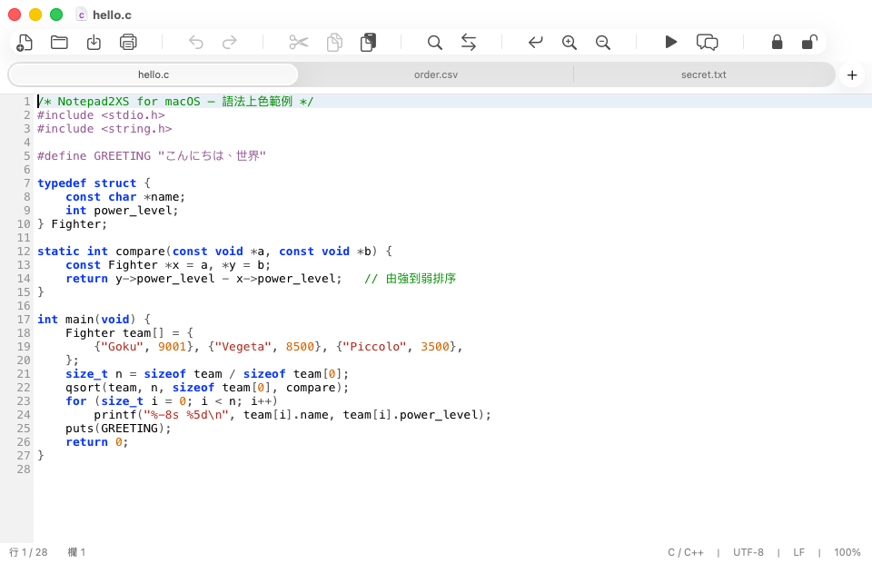

## 截圖

### 多分頁

和 TextEdit／Finder 一樣的 macOS 內建分頁。只有一個分頁時也會顯示分頁列與「＋」（可在設定關閉）：

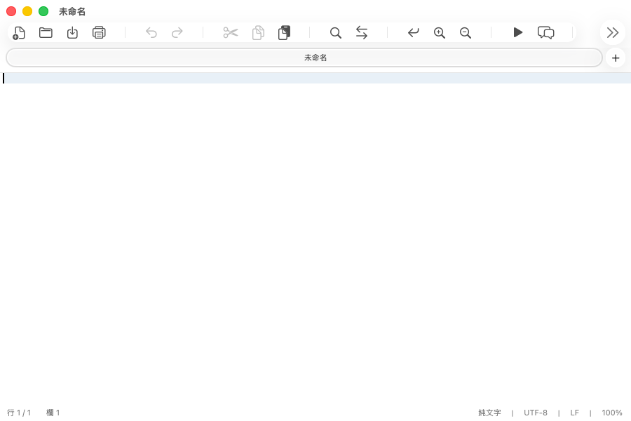

### 編輯與尋找

| 尋找與取代（醒目提示相同文字） | F5 執行選取（數學運算） |
|---|---|
| 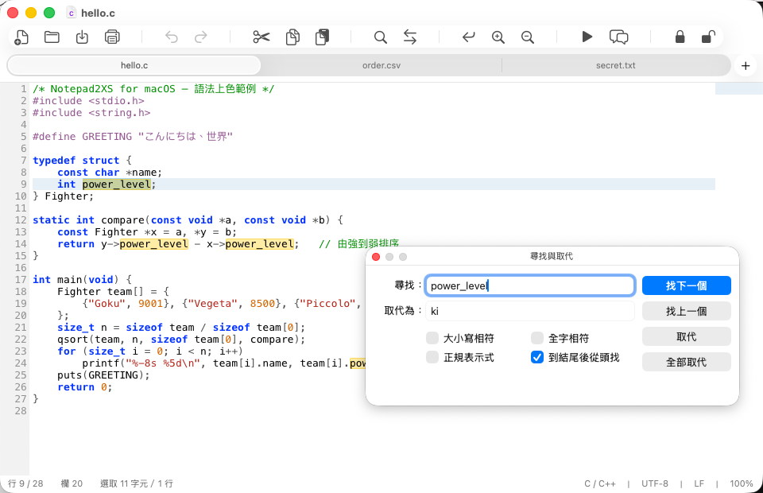 | 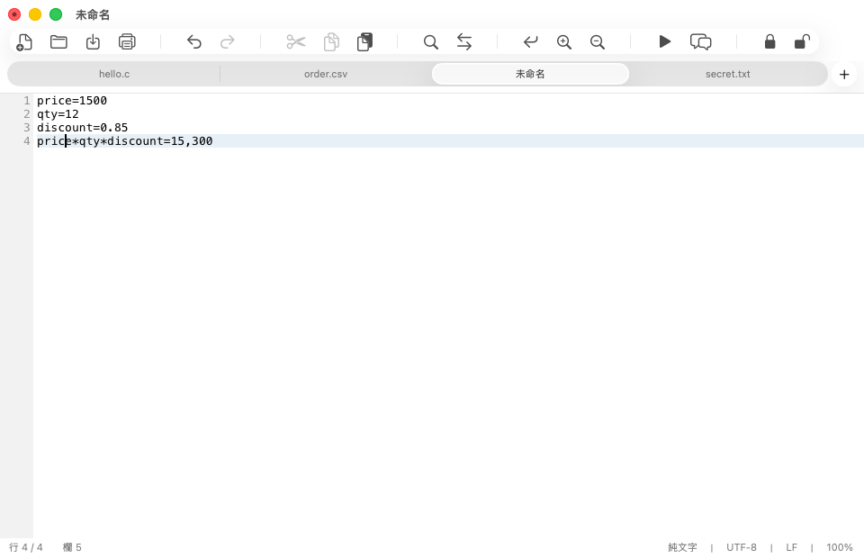 |

### 加密

| EXES 加密：文字密碼 | EXES 加密：金鑰檔案 |
|---|---|
| 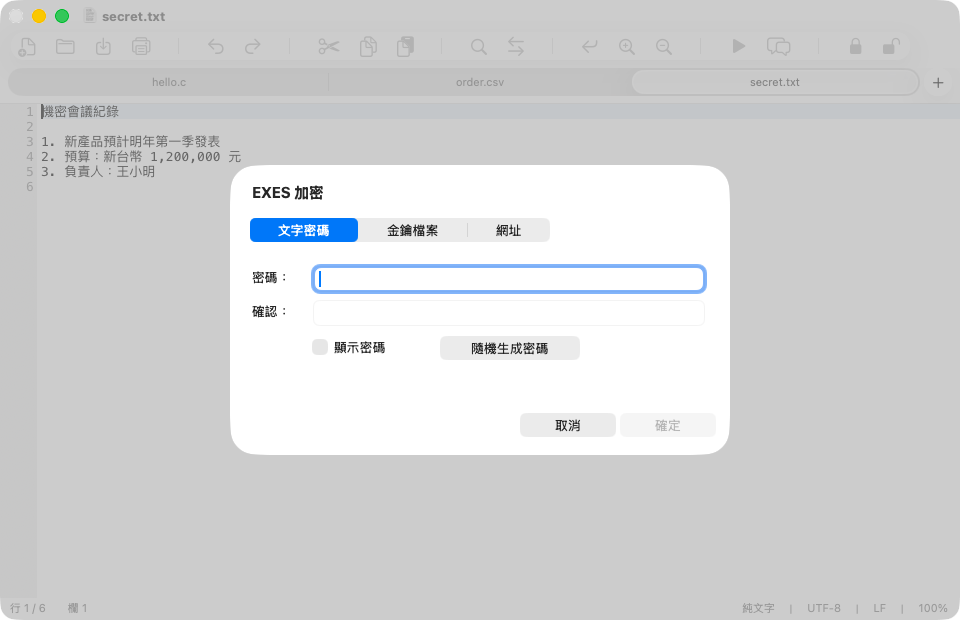 | 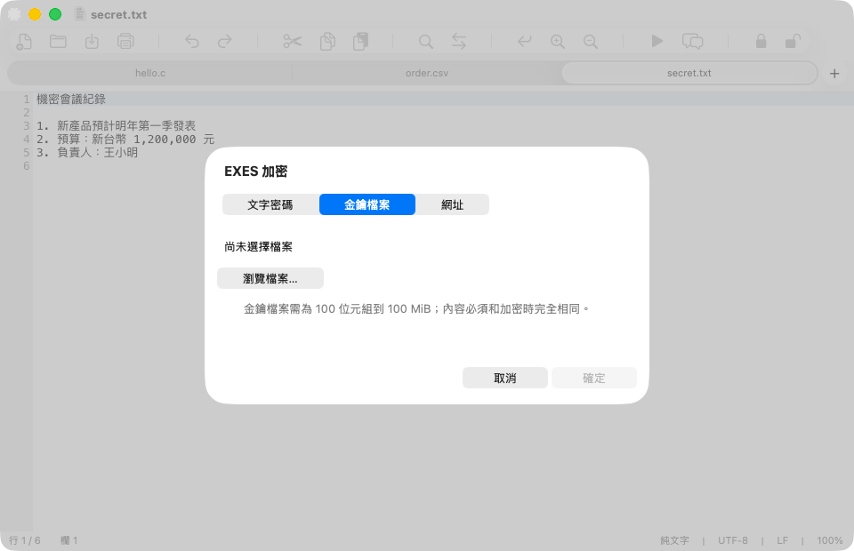 |

加密後的文件會鎖定為唯讀，標題列顯示加密狀態：

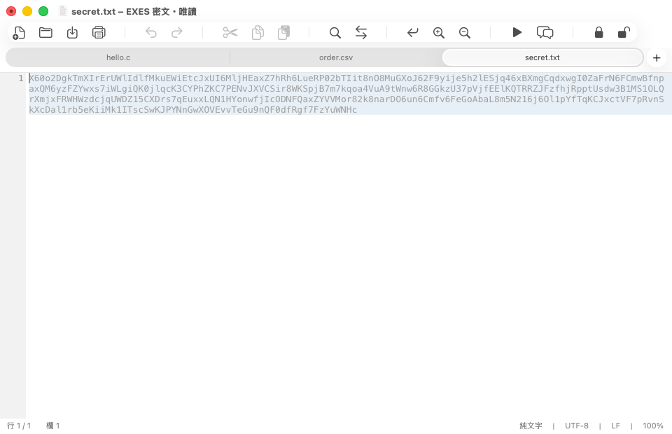

### 設定

| 一般 | 編輯 | 檢視 |
|---|---|---|
| 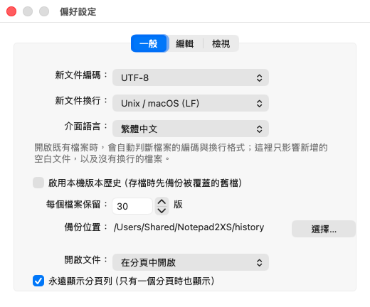 | 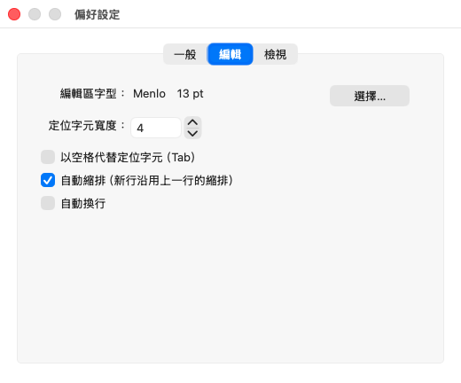 | 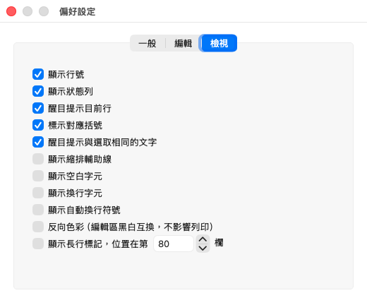 |

### 其他工具

| CSV 表格模式 | 人工智慧連接設定 |
|---|---|
| 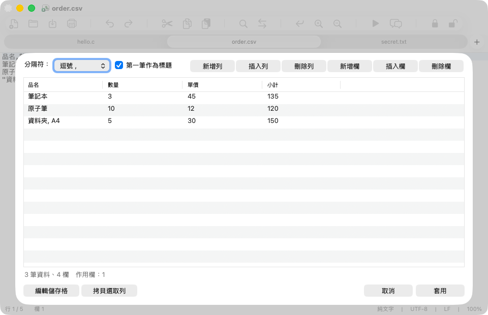 | 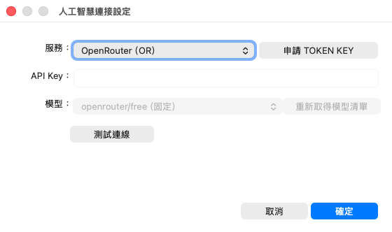 |

## 下載與安裝

到 [Releases](../../releases) 下載 `Notepad2XS.dmg`，把 App 拖進「應用程式」資料夾。

> 這個版本沒有 Apple 開發者簽章（只有 ad-hoc 簽章）。第一次開啟時請在 Finder 對 App **按右鍵 →「打開」**，
> 或到「系統設定 → 隱私權與安全性」允許開啟。

## 主要功能

| 類別 | 內容 |
|---|---|
| 編輯 | 語法上色、行號、自動換行、分割視窗、尋找／取代（含正規表示式）、行操作、區塊編輯、註解、大小寫與空白整理、排序 |
| 編碼 | UTF-8／UTF-8 BOM／UTF-16 LE・BE／Big5（與 CP950 一致）／GB18030／Shift-JIS／Windows-1252；自動偵測、以指定編碼重新載入 |
| 加解密 | EXES（`.x60`）與 AES-256-GCM（`.u2f`），密碼／金鑰檔案／網址金鑰；開檔自動解密、存檔自動加密；預設密鑰存在鑰匙圈 |
| 壓縮檔 | 直接編輯 ZIP／7Z／TAR（含 gz／bz2／xz）內的文字檔並回存（驗證後才替換）；其他格式先轉成 ZIP |
| F5 執行選取 | 數學運算式、中文金額、SQL（ODBC／iODBC）、HTTP、FTP、SSH、Shell 指令、`[SYSINFO]`（system_profiler） |
| 人工智慧 | OpenRouter、Google Gemini、NVIDIA、DeepSeek 連線設定與指令範本（API Key 存在鑰匙圈） |
| 其他工具 | CSV／TSV 表格模式、檔案搜尋、版本歷史、安全刪除、JPEG 內嵌文字（明文／AES／EXES）、EXMD3 雜湊、Base64／URL／QP／Hex 編碼 |
| 多分頁 | macOS 內建分頁列；設定可選「在分頁中開啟」或「在新視窗中開啟」、永遠顯示分頁列；滑鼠中鍵點分頁關閉；拖曳分頁、移至新視窗、合併所有視窗 |
| 工具列 | 原版 18 個預設按鈕；右鍵 →「自訂工具列…」可加入其他 25 個按鈕與分隔線；「檢視 → 重設工具列」還原 |

## 分頁快捷鍵

| 動作 | 快捷鍵 |
|---|---|
| 新增分頁 | ⌘T（或分頁列右側「＋」） |
| 關閉分頁 | ⌘W、滑鼠中鍵點分頁 |
| 下一個／上一個分頁 | ⌘⇧] ／ ⌘⇧[、⌃Tab ／ ⌃⇧Tab |
| 切換到第 1～8 個分頁 | ⌘1 ～ ⌘8 |
| 切換到最後一個分頁 | ⌘9 |
| 顯示所有分頁 | ⌘⇧\ |

「字型…」的快捷鍵改為 ⌃⌘T（⌘T 給新增分頁）。

## 從原始碼建置

需要 Xcode Command Line Tools（`xcode-select --install`）。

```bash
./build.sh            # Universal Binary（x86_64 + arm64）→ build/Notepad2XS.app
ARCH=x86_64 ./build.sh   # 只編單一架構（較快）
./build.sh dmg        # 另外打包 build/Notepad2XS.dmg
./tests/run_tests.sh  # 單元測試（編碼、文字轉換、加解密向量、F5、壓縮檔編輯）
```

第一次建置會先把 `vendor/scintilla3112` 編成 `build/libscintilla.a`。

## 專案結構

| 路徑 | 內容 |
|---|---|
| `src/` | App 本體（Objective-C++）：文件、編輯視窗、各功能視窗 |
| `src/core/` | 沿用原版的平台無關 C／C++ 程式碼（加解密、CSV、SQL 結果、檔案搜尋、安全刪除等） |
| `vendor/` | Scintilla 3.11.2（官方 Cocoa 版）、Boost.JSON 所需的精簡子集 |
| `resources/` | Info.plist、圖示、JPEG 預設底圖 |
| `tests/` | 單元測試與測試向量 |
| `PLAN.md` | 移植計畫、各階段實作紀錄與驗證結果 |

## 與 Windows 版的差異

- 沒有移植：WIM 格式、圖片轉文字、系統診斷（MIS）選單、開始選單整合等 Windows 專屬功能
- 原版 Scintilla 的 Boost.Regex 搜尋擴充尚未合併，正規表示式使用 Scintilla 內建引擎
- DPAPI → 鑰匙圈；WMI → `system_profiler`；WinHTTP → NSURLSession
- 多語系涵蓋選單、狀態列、尋找視窗與偏好設定；部分對話框訊息仍為繁體中文

## 授權

BSD 3-Clause（與 Notepad2 相同），詳見 [LICENSE](LICENSE)。第三方元件：Scintilla、Boost、TinyExpr，各自的授權檔案在 `vendor/` 與原始碼中。
